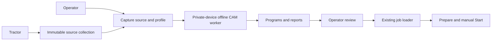

# Prepare copper isolation on Raspberry Pi

Computer-aided manufacturing (CAM) converts checked Gerber copper into tool
movements. The panel has two collections under **Plik → Z kolekcji**:

1. **Paczki z Tractor** retains immutable original packages.
2. **Programy obróbki** retains independent computation attempts and reports.

Select a source package, choose a measured fixed-depth profile in the existing
profile bar, set retract height, confirm the machining-side datum, and choose
**Oblicz izolację na RPi**. The computation continues if the browser closes.
Inspect the toolpath and checks, then explicitly load a successful isolation
program. Loading invalidates the previous surface map. Preparation and manual
Start remain separate. No computation opens USB or sends controller commands.

Only copper isolation is implemented. Drilling and outline cutting always show
**nieprzygotowane**. A ready isolation file does not make the whole board ready.
The optional original NC attachment workflow remains available.

## Geometry contract

The first engine uses Gerbonara 1.6.3 and Shapely 2.2.0. It reads the checked
source-bound Tractor isolation ZIP, including retained no-net copper. It requires
a closed rectangular line outline, one matching copper layer and clean source
validation/readback. Unknown parser warnings fail. It never alters the PCB,
nominal tool width, calibration or source files to obtain a passing result.

The effective diameter is `intercept_mm + slope * depth` from the selected
calibration. One contour pass offsets protected copper by radius plus 0.008 mm.
Gerber arc approximation is 0.001 mm; contour simplification is 0.004 mm; emitted
coordinates round to 0.00001 mm. These numerical budgets are recorded in reports.
The independent readback reconstructs paths from the emitted NC, checks cutter
sweep against protected copper, detects inaccessible boundaries and compares
remaining-stock connectivity with intended copper islands. A failure keeps a
coordinate-marked preview and report, but produces no selectable NC.

One transform comes from the original board outline. Front copper translates to
machined-side lower-left G54. Back copper also mirrors X. The matrix and original
outline bounds are saved for future operations; never centre drills or outline
independently. The preview is from the machined side, +X right and +Y up.

This conservative planar engine can reject geometry that another strategy could
machine. It does not infer electrical nets from Gerber or prove every machining
strategy impossible. It rejects rather than claiming a complete validated board.
Physical tool width, flatness, copper thickness, Z accuracy, clamps, material,
registration, spindle speed, cleaning and electrical isolation need operator
acceptance. The selected single-observation width model is not a full process
qualification. Isolation-only output proves neither holes nor board cut-through.

## Worker boundary and storage

Preparation requires a disconnected CNC, exact current profile fingerprint and
explicit datum confirmation. One worker runs at a time. A transient user systemd
unit has `PrivateDevices=yes`, `PrivateNetwork=yes`, `NoNewPrivileges=yes`,
1.5 GiB memory limit, 75% of one CPU, 32 tasks and a 180 second lifetime.
It cannot see physical USB devices or connect to the control HTTP API. Missing
sandbox support fails preparation. Cancellation stops only the CAM unit, never
the CNC. Restart recovery stops an orphaned unit and marks the attempt interrupted.

Results live separately at `~/.local/share/bark-beetle/cam/<id>/`. Each attempt
captures package ID, original ZIP hash, PCB hash, full profile snapshot and
fingerprint, parameters, implementation hashes, engine version and transform.
Final reports, preview, source copy and NC have byte hashes and a metadata hash.
The history is retained; no automatic deletion or overwrite. Limits are 100
attempts / 512 MiB, 100 ZIP entries / 32 MiB uncompressed, 1 MiB / 20,000 NC
commands. Profile or engine changes mark old results stale and prevent loading.

Operator-only APIs use `X-PiloMill-Token`; every POST also checks Origin:

| Route | Meaning |
| --- | --- |
| GET `/api/cam` | History and current freshness |
| GET `/api/cam/preview/:id` | Finalized, hash-checked geometry |
| POST `/api/cam/prepare` | packageId, name, profileFingerprint, clearanceMm, confirmedDatum |
| POST `/api/cam/cancel` | Cancel computation by id |
| POST `/api/cam/select` | Recheck artifact/source/profile, then existing job_load |

The Tractor ingestion credential has no access to these routes. There is no
CAM Start API. The existing sender remains the only serial owner.

## Install and verify

On a supported Linux host, install direct pinned dependencies into the existing
monitor environment: `.venv/bin/python -m pip install -r requirements-cam.txt`.
The service needs a working user systemd manager and private-device/network
namespaces. Rebuild the existing frontend in `ui/` with `npm run build`.

Run `.venv/bin/python -m unittest discover -s tests -p 'test_*.py'`.
`tests/test_cam.py` exercises actual Gerber fixtures, calibrated offsets, polarity,
narrow-gap blocking, altered NC sweeps, common datum/mirror, source binding,
archive paths, profile freshness, interrupted attempts and HTTP permissions.
Tests never open the controller. Preserve dirty checkout work and hash-check each
replaced file; restart only an inactive, disconnected station with a rollback copy.

The 2026-11-08 RPi acceptance also ran real sandboxed computations, cancelled a
running computation and checked that the CNC remained disconnected with an empty
job. Miniroom's current package was rejected by the planar checks, with no NC
available for loading. This is diagnostic evidence, not production approval.
