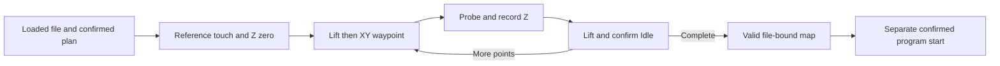

# PCB surface measurement and compensation

The File tab builds a grid from the uploaded program's X/Y bounds in G54 work
coordinates. Positive X points right and positive Y points up. The diagram is a
machining rectangle, not a detected PCB (printed circuit board) edge. It cannot
locate copper or clamps. Confirm those physically before starting.

## Operator workflow

1. Connect CNC, establish material X/Y zero and verify the probe input as
   described in [single-point Z probing](z-probe.md). Keep the spindle off and
   connect the tool clip and exposed copper.
2. Upload the program. Choose 3 x 3, 5 x 5 or a custom grid (2 to 11 per axis).
   Area editing can extend, but cannot omit, a programmed region.
3. Position the tool close above copper at the current X/Y. Start measurement
   and confirm. The first touch is a reference at that current point, followed
   by the selected grid. It is one extra touch beyond the grid point count.
4. Watch the map and progress. Each measured point shows signed delta Z in mm
   relative to surface height at X=0, Y=0. Brown is higher, blue lower and green
   zero (rounded to 0.001 mm); gray points are pending. Min/max and total height
   difference summarize the measured area. Dense grids can be scrolled.
   Stop aborts the whole scan; it cannot resume a partial map.
5. When the map is complete, remove the tool clip before starting the spindle.
   The compensation checkbox is enabled and selected for the matching plan.
   Program Start still requires a separate confirmation and states whether
   compensation will be used.

The first reference touch sets G54 Z=0 without changing X/Y. Default first
descent is at most 1 mm at 20 mm/min. Position the tool closer than that to copper.
The tool then retracts to Z=2 mm before every XY move. At each grid point it
probes down toward Z=-1 mm, records the contact and retracts before moving on.
It ends over the last point at the configured clearance, not at X/Y zero.

Measurement parameters allow first descent 0.1–5 mm, clearance 1–3 mm, lower
search depth 0.1–2 mm and probe feed 10–60 mm/min. Total grid descent cannot exceed
5 mm. XY travel is feed-controlled at 100 mm/min. Ensure the configured clearance
clears the PCB and all fixtures along the entire route.

## Ownership, validity and failures

The displayed origin uses a measured grid point at 0,0 when available, otherwise
the initial reference touch if it was at 0,0. An origin inside the grid can use
bilinear interpolation once all required neighbours have been measured; the UI
labels this explicitly. There is no extrapolation outside the map. Until a
baseline exists, points show that a measurement exists without claiming a delta.
The point list uses the same deltas. This display conversion does not change raw
probe heights, reference zero or compensation. Three decimal places are display
precision, not a claim of machine accuracy.

The RPi generates and validates every point; the browser does not supply an
unchecked movement list. The existing single serial owner performs probing.
The initiating browser alone owns an 8-second heartbeat lease, including XY
travel. Alarm, timeout, lost status/connection, unexpected coordinates, changed
offset or Stop aborts through hold/reset and closes CNC. No retry or resume
occurs. Reference zero may already have changed: reconnect and establish zero
again after failure. A partial map is never valid compensation.

Completed maps are bound to the uploaded file identity and the captured work
offset. Reloading/clearing a file, manual zero, new single-point Z probing,
polarity changes, disconnect and service restart invalidate them. A changed WCO
(work coordinate offset) invalidates the map; it also aborts a compensated job.
Map data lives only in RPi memory. Physical stock/tool changes cannot be detected:
repeat the measurement after changing the tool, PCB placement or clamps.

## Compensated execution

Start with compensation verifies the selected map and reads current G54, G92 and
tool offsets using GRBL's read-only `$#` query. An outdated or incomplete map
blocks that compensated start. The original uploaded program remains unchanged.
A separate execution stream uses bilinear height interpolation. Feed moves are
split into XY segments no longer than 0.5 mm or half a grid interval, whichever
is smaller, and their Z follows the measured surface. Rapid moves retain at
least the original positive clearance above the map's maximum height. G0 below
the surface, extrapolation, invalid values and more than 20000 output commands
are rejected before the job starts. The generated stream passes the normal
program validator and preserves source-line references for errors.

Selecting a different grid/area hides the old map's compensation control until
the plan matches again or is remeasured. Unchecking compensation runs the
original file; the Start dialog states that choice explicitly. Use the same
tool and mounting that were measured.

## API and verification

`surface_start` requires confirmed, job_id, expected position, columns, rows,
area, first-probe distance/feed, clearance and lower search depth. It returns
the existing private probe lease; `probe_heartbeat` and `probe_stop` control it.
Status exposes `cnc.surface_map`; the shared `cnc.z_probe` identifies the active
scan with kind=surface. `job_start.surface_map_id` selects compensation.

Run the Python test suite plus `node tests/test_surface_plan.cjs`,
`node tests/test_web.cjs`, `node tests/test_probe_web.cjs` and the UI build.
Simulated tests cover all grid phases, safe lift-before-XY ordering, reference
zero, partial/failure paths, map invalidation, interpolation, source preservation
and compensated serial output. Browser checks cover confirmations, progress,
Stop, heights, selection and stale-map rejection on desktop and portrait phones.
The repository's 10 mm air-check and copper programs also pass compensated
generation. Physical grid scanning and compensated milling require their first
supervised machine run; deployment does not execute either.

