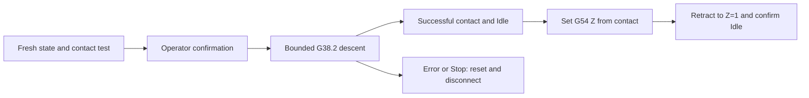

# Probe input and automatic Z zero

The topbar shows the current logical PROBE input reported by GRBL, the machine
controller firmware. Green **STYK** means triggered, gray **BRAK STYKU** means
not triggered, and amber **BRAK ODCZYTU** means disconnected, stale or unknown.
It is a digital contact indication, not a voltage measurement or proof that the
probe wire is connected. A fresh GRBL report without `Pn:P` means not triggered.
Firmware that omits pin reporting cannot pass the required contact test.

The existing serial owner reads `?` status reports. No extra serial connection,
motion command or settings write is used for the indicator. Browser polling is
500 ms while connected; the idle serial poll is also 500 ms. Hold the clips
together for at least one second when testing.

## Operator workflow

1. Connect the probe wiring with machine power off: GND to the metal tool and
   S to exposed copper. Leave 5V unused. Keep the spindle switched off.
2. Power on, then explicitly connect CNC in the panel. Opening serial may reset
   the controller; do not do this during machining.
3. Touch the clips together until STYK appears, then separate them and verify
   BRAK STYKU. This test is required after every connection. Do not start if the
   indicator does not change or has reversed behavior.
4. Position the tool close above copper and make sure a 1 mm upward retract
   above the contact surface is clear. Use no separate touch plate or paper.
5. In Zero, choose maximum descent (0.1 to 5 mm; default 1 mm) and feed
   (10 to 60 mm/min; default 20). Choose the smallest practical descent.
6. Select automatic Z zero and confirm at the machine. The tool descends only
   along Z, sets the copper contact as G54 Z=0, then moves to Z=1 mm.
7. Remove the tool clip before starting the spindle. Check the result before
   machining. This is a single-point zero, not a surface height map.

## Guards and failure behavior

Start requires Idle, no active file job, a fresh work position and MPos (machine
position), a successful input test and an untriggered input. The backend checks
the confirmed position again, current modal G54/G21/G90/G94/M5, and the connection
settings `$6=0` and `$13=0`. It never changes those settings automatically.

The bounded `G38.2` descent must return a successful `[PRB:...:1]` and subsequent
Idle. The controller's captured machine position is used to compensate for
stopping overshoot before `G10 L20 P1` assigns the Z offset. Only then does an
absolute `G0 Z1` retract run. X/Y are neither moved nor zeroed. Feed is left at
the probing value; jog commands and supported file jobs specify their own feed.

Only the initiating browser has the probe heartbeat lease. Other viewers cannot
keep its motion alive. Stop, browser loss beyond 8 seconds, timeout, alarm, reset,
unexpected coordinates, missing status or serial failure abort through hold and
reset, then close the connection. No automatic retry, resume or reconnect occurs.
After abort, check the machine and spindle and establish zero again. An abort
after offset assignment may already have changed Z; no success is reported until
the retract finishes. The topbar Stop is available during every active phase.

## API and validation

`cnc.probe_triggered` is true, false or null. `cnc.probe_tested` records a triggered
Idle report since this connection. `cnc.z_probe` exposes phase, active state and
error. CSRF-protected actions are `probe_start` (confirmed, distance, feed and
expected position), `probe_heartbeat` (owner lease) and `probe_stop`.
Only explicit start returns the private `probe_lease`; status does not expose it.

Run `python -m unittest discover -s tests -v`, `node tests/test_web.cjs`,
`node tests/test_probe_web.cjs`, and the UI build. Local browser checks use a mock
API. Hardware-free tests cover pin transitions/staleness, start guards, contact
versus overshoot, completion, cancellation, malformed results, lease loss and
timeouts. Physical probing still needs its first supervised validation on this
machine. Deployment itself does not initiate motion or reconnect CNC.
